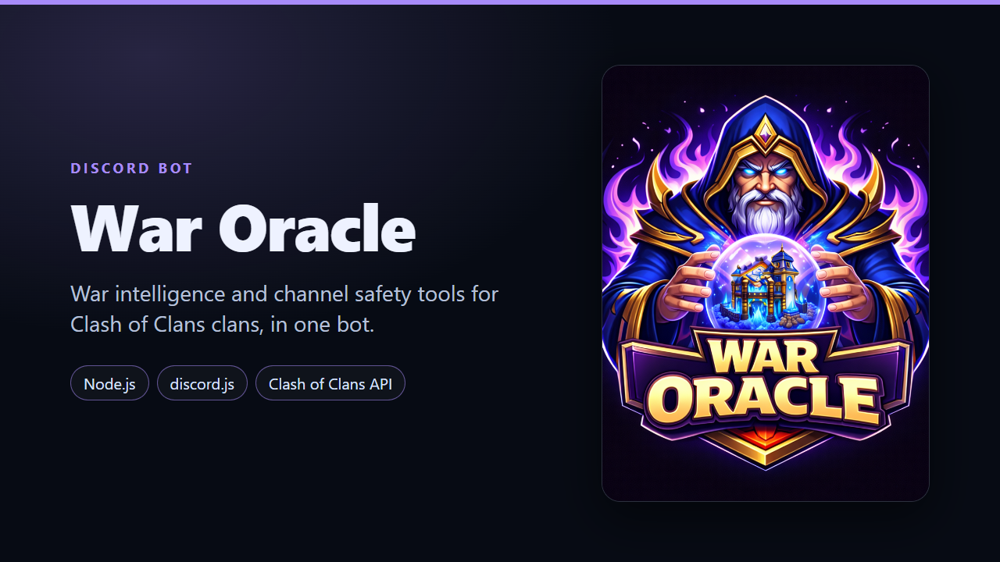

# War Oracle

[](https://github.com/PHTMGatt/War-Oracle-Bot/actions/workflows/ci.yml)



**War Oracle** is a Discord bot for **Clash of Clans** clans: war intelligence plus a few channel safety tools, in one bot with one token.

> **Merged.** It now also covers what **Clash-Commander-Bot** did (channel lockdown, cleanup, identity). That repo is superseded by this one.

It watches the active war, posts clean status and stats, and sends **non-spammy** threshold alerts so leadership never has to babysit a war.

---

## ⚔️ Commands

| Command | Who | What it does |
| --- | --- | --- |
| `/ping` | anyone | Online check + uptime |
| `/war status` | anyone | Posts current war status (score, remaining attacks, who still has attacks) |
| `/war stats` | anyone | Posts the last saved snapshot (stars, destruction, missed attacks) |
| `/war alerts mode:on\|off` | anyone | Toggles threshold alerts (resets to on at restart) |
| `/lockdown` / `/unlock` | Manage Channels | Stop / allow @everyone sending in this channel |
| `/cleanup count:<1-50>` | Manage Messages | Deletes the bot's own recent messages in this channel |
| `/whoami` | Manage Server | Shows the bot's roles and permissions here |

Alerts fire once per threshold per war (default 12h, 2h and 30m before the war ends) and only while someone still has attacks left.

> **Not here (yet):** the old Clash Commander README promised `/audit`, `/note`, `/notes`, `/inactive`, `/ping mods|leaders`, but none of that was ever built. There is no town hall manager or base-link feature in either bot.

---

## 🔗 Invite the Bot

👉 **[Invite War Oracle](https://discord.com/oauth2/authorize?client_id=1465421621874397298&scope=bot%20applications.commands&permissions=0)**

Slash commands are registered automatically on startup. `/lockdown`, `/unlock` and `/cleanup` need the bot to have Manage Channels / Manage Messages in the channel.

---

## ⚙️ Setup

Requires Node 20+. Create the bot in the [Discord developer portal](https://discord.com/developers/applications) (no privileged intents needed) and get a key from the [Clash of Clans developer portal](https://developer.clashofclans.com).

> **The Clash API key is locked to the public IP you register.** Moving the bot to a new machine (for example a Raspberry Pi) means creating a new key for that IP.

```bash
npm install
npm start
npm test        # unit tests (also run by CI)
```

### Environment variables

Set in a git-ignored `.env` file or the process environment. **Tokens live only in env, never in git.**

| Variable | Required | Used for |
| --- | --- | --- |
| `DISCORD_TOKEN` | yes | Bot login |
| `COC_TOKEN` | for war features | Clash of Clans API key |
| `CLAN_TAG` | for war features | Clan tag, `#2PP0` style (`%232PP0` also works) |
| `GUILD_ID` | no | Register slash commands to one server (instant) instead of globally (up to an hour) |
| `BOT_COMMANDS_CHANNEL_ID` | no | Lock all commands to one channel |
| `WAR_STATUS_CHANNEL_ID` | no | `/war status` posts here (default: the channel it was run in) |
| `WAR_ALERTS_CHANNEL_ID` | for alerts | Threshold alerts post here |
| `WAR_STATS_CHANNEL_ID` | no | `/war stats` posts here (default: the channel it was run in) |
| `POLL_SECONDS` | no | Poll interval, min 30, default `180` |
| `ALERT_MINUTES` | no | Alert thresholds, default `720,120,30` |
| `DATA_DIR` | no | Where `war_snapshot.json` is written, default `./data` |

---

## 🥧 Deploy on a Raspberry Pi

```bash
# Node 20+ (e.g. via NodeSource), then:
git clone -b claude-forge https://github.com/PHTMGatt/War-Oracle-Bot.git
cd War-Oracle-Bot
npm ci --omit=dev
nano .env          # DISCORD_TOKEN, COC_TOKEN, CLAN_TAG, channel ids (chmod 600 .env)
```

`/etc/systemd/system/war-oracle.service`:

```ini
[Unit]
Description=War Oracle Discord Bot
After=network-online.target
Wants=network-online.target

[Service]
WorkingDirectory=/home/pi/War-Oracle-Bot
ExecStart=/usr/bin/node src/index.js
EnvironmentFile=/home/pi/War-Oracle-Bot/.env
Restart=always
RestartSec=5
User=pi

[Install]
WantedBy=multi-user.target
```

```bash
sudo systemctl daemon-reload
sudo systemctl enable --now war-oracle
journalctl -u war-oracle -f
```

The bot only makes outbound connections (Discord and the Clash API), so no router ports need opening. Remember to register the Pi's public IP on the Clash API key.

---

## ✅ CI

GitHub Actions runs install, tests, `npm audit --audit-level=high`, a secrets scan (gitleaks) and a config check on every PR and `claude-forge` push. No secrets needed.

---

Built with **discord.js** and the **Clash of Clans API**.
